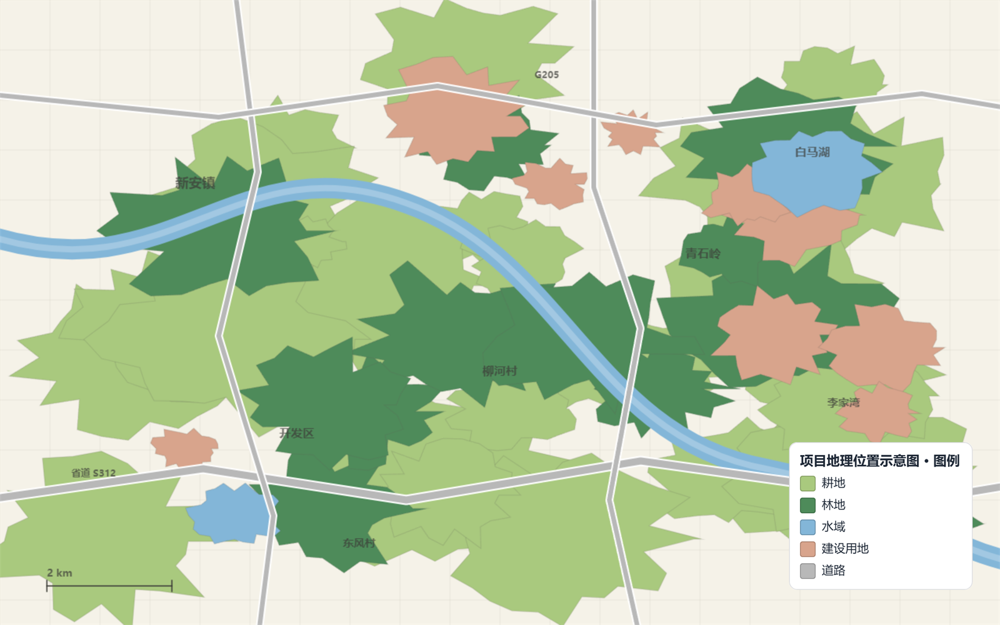
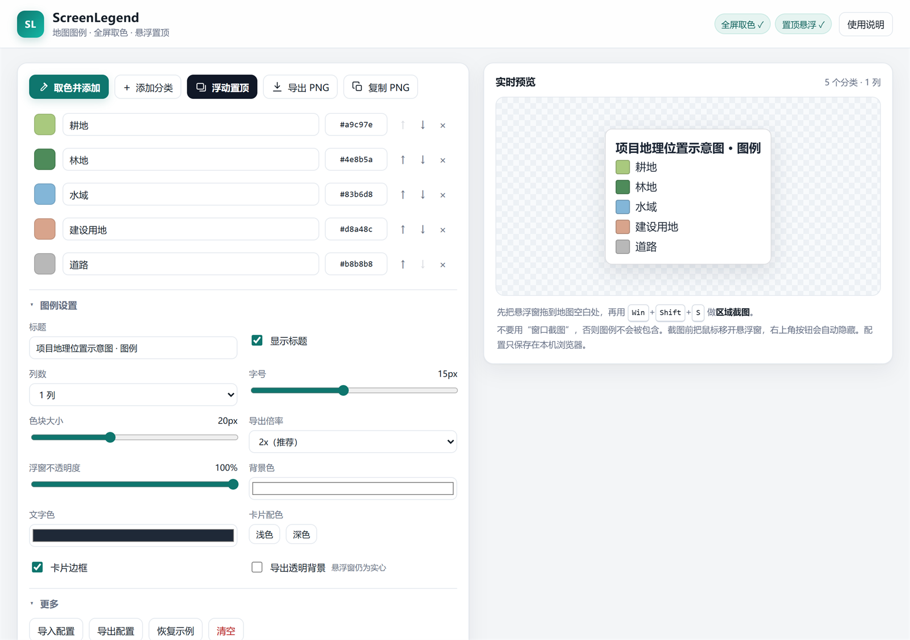

# ScreenLegend

地图图例制作 + 全屏取色 + 系统级置顶悬浮窗。适用于奥维互动地图、QGIS、Google Earth 等任何软件的“项目地理位置示意图”截图流程。

传统做法是：截图 → Photoshop 取色 → 画图例 → 拼图。
ScreenLegend 把它变成：**取色 → 输入名称 → 悬浮窗盖在地图上 → 区域截图**。

> 上图：图例以小窗形式浮在地图上，无标题栏、无按钮，区域截图时只有图例本身。

## 下载

前往 [Releases](https://github.com/LDecem/ScreenLegend/releases/latest) 下载 `ScreenLegend-v1.0.0.zip`，解压后双击 **`启动.bat`** 即可，**无需安装**。

也可以直接克隆本仓库（只要 `index.html` + `启动.bat` + `tools/` 三个东西就能跑）。

## 界面

左边编辑图例（取色、名称、HEX、排序、列数、字号、色块、配色、浮窗不透明度），右边实时预览，一键导出 PNG。

## 快速开始

1. 双击 `启动.bat`：打开编辑器的同时，会在后台启动一个不可见的小程序（负责画置顶浮窗）。
   也可以直接双击 `index.html`，但那样没有小程序，浮窗会退回浏览器画中画模式。
2. 点击 **取色并添加**，鼠标变成取色器；在地图软件里点一下专题色块。输入分类名称。
3. 重复第 2 步，直到图例完整。每行都可以单独改名称、HEX、颜色、顺序。
4. 点击 **浮动置顶**：屏幕上出现一个**没有标题栏、没有最小化/最大化/关闭按钮**的图例小窗，系统级置顶，默认落在屏幕右下角。
5. 把它拖到地图空白处，用 `Win + Shift + S`、PixPin 或 ShareX 做 **区域截图**，把地图和图例一起截进去。

> **浮窗为什么没有标题栏**
>
> 普通浏览器窗口的标题栏是 Chromium 画的，网页改不掉它（显示文件路径、带三个按钮）。所以浮窗不用浏览器窗口：`启动.bat` 里的小程序在 `127.0.0.1:8777` 上接收编辑器发来的图例 PNG，用一个**无边框、逐像素透明、始终置顶**的原生窗口显示它。
> 窗口尺寸 = 图片尺寸 = 图例 CSS 尺寸 × 屏幕缩放，所以**永远是 1:1 像素对齐，不会模糊**，截图里也只有图例本身。

## 浮窗说明

- **移动**：按住图例任意位置拖动（用的是系统拖动，很跟手）。
- **关闭**：在浮窗上**右键**，或再点一次 **浮动置顶**。
- **实时更新**：改名称、颜色、字号、列数，浮窗立刻跟着变；图例变大变小时窗口自动重新贴合。
- **不透明度**：设置里的「浮窗不透明度」滑块（20%–100%）只影响浮窗，不影响导出的 PNG；配合透明背景可以让地图更清楚地透出来。
- **透明**：勾选 **导出透明背景** 后，浮窗背景也是真透明的（白色部分会让下面的地图透出来）。整块浮窗区域都能拖动，透明处也一样。
- 浮窗位置默认在右下角；拖动后本次运行期间保持在拖动后的位置。
- 关闭编辑器页面时浮窗会一起消失；小程序空闲 30 分钟后自动退出。

## 功能

- **全屏取色**：EyeDropper API，可在任意软件窗口上取任意像素，不限制在地图软件内。
- **系统级置顶（无边框）**：原生分层窗口 + 置顶，无标题栏、无按钮、无边框，尺寸与图例严格 1:1。
- **图例编辑**：色块 + 名称 + HEX、上下排序、删除、1–4 列、字号、色块大小、背景/文字色、边框、浅色/深色卡片。中文输入法可正常使用。
- **导出 PNG**：1x/2x/3x，可选透明背景，可复制到剪贴板。
- **自动保存**：配置保存在本机 `localStorage`，可导入/导出 JSON 模板。
- **零联网**：只在本机 `127.0.0.1` 上通信，不访问外网，不收集数据。

## 浏览器要求

- Microsoft Edge 或 Google Chrome（推荐用 `启动.bat` 打开）
- 需要 `EyeDropper`（取色）；置顶浮窗需要 Windows PowerShell 5.1（系统自带）
- 没有小程序时（例如直接打开 `index.html`，或用 Firefox），浮窗会退回浏览器画中画 / 页面提示

## 透明背景

1. 勾选 **导出透明背景**
2. 浮窗会直接变成真透明（只剩色块和文字浮在地图上）；导出 PNG 也会是透明背景

透明导出时，文字色请选与底图对比明显的颜色（深色底图用浅色文字）。

## 注意事项

- 截图必须用 **区域/全屏** 截图；用“窗口截图”只截地图窗口，不会带上悬浮图例。
- 地图软件请用 **窗口化** 或 **无边框全屏**；独占全屏（尤其 DirectX）可能盖住置顶窗。
- 浮窗会盖住下面的应用；编辑图例时如果被挡住，右键关掉浮窗，编辑完再打开。
- 远程桌面、虚拟机或部分受保护程序里，置顶可能失效。
- 杀毒软件若拦截 PowerShell 脚本，浮窗会退回浏览器画中画模式（有控制条，但不影响编辑/导出）。
- 如果 `file://` 下 EyeDropper 或剪贴板被浏览器限制，可改用本地 HTTP 服务打开（例如在目录里运行 `python -m http.server`，再访问 `http://localhost:8000/`）；此时置顶浮窗仍可用。

## 文件

- `index.html` — 工具本体（单文件，内联 CSS/JS）
- `启动.bat` — 启动后台浮窗小程序 + 用 Edge 应用窗口打开编辑器
- `tools\legend-overlay.ps1` — 无边框置顶浮窗小程序（本地 8777 端口）
- `README.md` — 本文件
- `LICENSE` — MIT

## License

MIT
